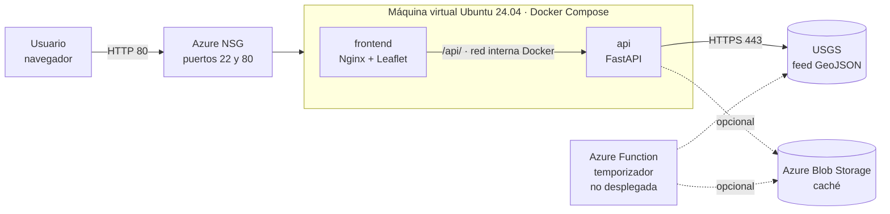
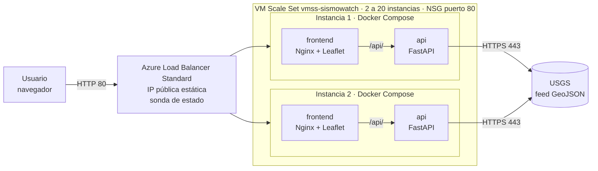

<h1 align="center">SismoWatch</h1>
<p align="center"><b>Monitoreo sísmico global en tiempo real, diseñado para la nube</b></p>
<p align="center"><i>Cada sismo, en tiempo real.</i></p>

<p align="center">
  <a href="http://sismowatch.eastus.cloudapp.azure.com/"><b>▶ Servicio en producción (versión 1)</b></a> (HTTP)<br>
  Balanceador de carga (versión 2): [PEGAR URL DEL BALANCEADOR]
</p>

---

**Autores:** Guillermo Hernández, Santiago Quiroz y Sebastián Restrepo
**Institución:** Universidad Militar Nueva Granada (UMNG), Ingeniería en Telecomunicaciones
**Curso:** [COMPLETAR]
**Repositorio:** [PEGAR URL DE GITHUB]

Leyenda de estados usada en todo el documento: ✔ implementado · ◐ parcial · ○ planificado

---

## 1. Resumen

SismoWatch es un servicio web público que muestra en un mapa los terremotos ocurridos en el mundo y avisa, con una animación y un sonido, cuando aparece un sismo nuevo. Los datos provienen del *Earthquake Hazards Program* del Servicio Geológico de los Estados Unidos (USGS).

El proyecto se desarrolló como caso práctico de **aplicaciones nativas de la nube**: microservicios, contenedores, automatización DevOps, funciones sin servidor y diseño orientado a la resiliencia y la escalabilidad, desplegado en **Microsoft Azure**. Existen dos versiones del despliegue:

- **Versión 1 (producción simple):** una máquina virtual con Docker Compose.
- **Versión 2 (escalable):** un *Virtual Machine Scale Set* (VMSS) detrás de un *Azure Load Balancer*, con autoescalado por CPU.

## 2. Caso de negocio

> Nota: las secciones de mercado y financiamiento son **hipótesis de trabajo** que deben validarse con clientes reales; no se incluyen cifras de mercado no verificadas.

### 2.1 Problema
La información sísmica existe y es pública, pero se presenta en herramientas pensadas para especialistas: catálogos extensos, formatos técnicos y poca capacidad de alerta inmediata. Las organizaciones que dependen de la continuidad de sus operaciones necesitan una vista **simple, en vivo y accionable**.

### 2.2 Cliente objetivo
- Aseguradoras y reaseguradoras (seguimiento de eventos que pueden generar siniestros).
- Constructoras e ingeniería (conciencia del riesgo en proyectos y obras).
- Logística y operadores de infraestructura (rutas, bodegas, plantas).
- Entidades públicas y gestión del riesgo a nivel local.
- Instituciones educativas (divulgación y enseñanza).

### 2.3 Propuesta de valor
- Mapa en tiempo casi real con filtros por periodo, magnitud, profundidad y país o región.
- **Aviso inmediato** cuando aparece un sismo nuevo: pulso visual y sonido. El sistema informa eventos ya ocurridos; no los predice.
- Ficha de detalle dentro de la propia página, con explicaciones en lenguaje sencillo (por ejemplo, qué significa el tipo de magnitud *mww* o *md*).
- Arquitectura portable, que puede ejecutarse en cualquier nube.

### 2.4 Modelo de negocio (hipótesis)
| Nivel | Contenido |
|---|---|
| Gratuito | Mapa público, filtros y detalle de eventos. |
| Profesional | Alertas configurables por zona y magnitud (correo, mensajería), historial y exportación. |
| Empresarial | API con acuerdo de nivel de servicio, panel por organización y soporte. |

### 2.5 Uso previsto de fondos (a definir por el equipo)
Infraestructura con alta disponibilidad, módulo de alertas multicanal, integración de fuentes adicionales (regionales y de otras agencias), aplicación móvil y validación comercial con los primeros clientes.

### 2.6 Riesgos y mitigación
| Riesgo | Mitigación |
|---|---|
| Dependencia de una única fuente de datos | Caché y respaldos en cascada. La incorporación de nuevas fuentes está planificada (○); la carpeta `function/` es un primer paso, aún no desplegado. |
| Competencia de mapas gratuitos | Diferenciación en alertas, experiencia de uso, API y soporte. |
| Caída de un servidor | Reinicio automático, verificaciones de salud y, en la versión 2, varias instancias detrás de un balanceador con sonda de estado (sección 11). |

## 3. Trabajo realizado

### 3.1 Funcionalidades
- Mapa interactivo (Leaflet) con círculos proporcionales a la magnitud y color por profundidad o magnitud.
- Actualización automática cada 30 segundos y **detección de sismos nuevos** con animación de punto rojo expansivo y sonido (Web Audio; el navegador exige un clic previo en la página). El botón «Repetir últimos» permite demostrar la animación con los 3 sismos más recientes.
- Panel lateral ocultable con filtros: periodo (1 h, 24 h, 7 d, 30 d), magnitud mínima, profundidad, texto, país o región (deducido del texto del evento), solo lo visible en el mapa, aviso de tsunami y sismos sentidos.
- Panel de detalle con hora local (Bogotá) y UTC, coordenadas, profundidad, alerta PAGER, intensidades, calidad del dato y el **método de cálculo de la magnitud explicado**.
- Pantalla de carga con el logotipo y porcentaje de avance real; ícono de la pestaña con el logotipo.
- Mapas base oscuro, claro, calles y satélite (Esri y OpenStreetMap); diseño adaptable a celulares.
- Enlace compartible por sismo (`#id`).

### 3.2 Fuente de datos
Se eligió el feed GeoJSON de USGS porque es público, gratuito, no requiere llave, se actualiza cada minuto aproximadamente, tiene cobertura global y formato estándar.

**Evaluación del Servicio Geológico Colombiano (SGC).** Se probó integrar los archivos públicos del SGC. Desde la máquina virtual en Azure el servidor del SGC respondió `AccessDenied` aunque la petición se identificara como navegador, y desde el navegador los datos no pueden leerse porque el servidor no envía las cabeceras CORS. Además, entrega las coordenadas como [latitud, longitud, profundidad] y no como GeoJSON estándar. Por ello la versión final usa únicamente USGS. La incorporación de otras fuentes queda como trabajo futuro (○).

## 4. Arquitectura

### 4.1 Versión 1: una máquina virtual



### 4.2 Versión 2: VMSS con balanceador de carga



Las instancias del VMSS se crean a partir de la imagen `img-sismowatch` (copia de la VM de la versión 1 con el proyecto movido a `/opt/sismowatch`), con orquestación *Flexible*, tamaño Standard D2as v4 y sin IP pública por instancia.

### 4.3 Flujo de una consulta
El navegador pide la página al contenedor `frontend` (Nginx); las peticiones a `/api/` y `/health` se reenvían por la red interna de Docker al contenedor `api`, que responde desde su caché en memoria (30 s), desde Blob Storage si está configurado, o consulta directamente a USGS. Si la API falla, la página consulta a USGS directamente desde el navegador. En la versión 2, el balanceador reparte las peticiones entre las instancias que superan la sonda de estado.

## 5. Cumplimiento de los principios de diseño nativo de la nube

| Principio | Implementación | Estado |
|---|---|---|
| Microservicios | Dos servicios independientes (`frontend` y `api`) que se comunican por HTTP/JSON | ✔ |
| Contenedorización | Un `Dockerfile` por servicio; Docker Compose | ✔ |
| Orquestación | Docker Compose con red, reinicio automático y *healthcheck*. Kubernetes no se implementó | ◐ |
| DevOps y CI/CD | GitHub Actions: pruebas, construcción con prueba de humo y despliegue por SSH (requiere secretos) | ✔ / ◐ |
| Sin servidor | Código de Azure Function (ingesta por temporizador hacia Blob Storage) en `function/`; **no está desplegada** | ◐ |
| Resiliencia | Reinicio automático, verificación de salud, sonda del balanceador, respaldos en cascada y tiempos de espera. Sin reintentos con retroceso exponencial ni *Circuit Breaker* | ◐ |
| Escalabilidad | VMSS con balanceador de carga y autoescalado por CPU (sección 11) | ✔ |
| Independencia del proveedor | Docker/Compose funciona en cualquier nube; Azure se usa solo como infraestructura | ✔ |

## 6. Tecnologías

Python 3.12 · FastAPI · Uvicorn · HTTPX · Nginx · Leaflet · JavaScript · Docker · Docker Compose · GitHub Actions · Azure (VM Ubuntu 24.04, NSG, IP pública con nombre DNS, Virtual Machine Scale Set, Load Balancer Standard, Azure Monitor) · Azure Functions y Blob Storage (código opcional, no desplegado).

## 7. Estructura del repositorio

```
sismowatch/
├── api/                    # Microservicio de datos (FastAPI)
│   ├── main.py
│   ├── test_main.py        # Pruebas automáticas
│   ├── requirements.txt
│   └── Dockerfile
├── frontend/               # Microservicio web (Nginx + Leaflet)
│   ├── index.html
│   ├── nginx.vm.conf       # Proxy inverso hacia la API
│   └── Dockerfile
├── function/               # Azure Function de ingesta (opcional, no desplegada)
├── docker-compose.yml      # Ejecución local
├── docker-compose.vm.yml   # Ejecución en la máquina virtual
├── deploy.sh               # Alternativa: Azure Container Apps (no usada en producción)
├── docs/img/logo.png
└── .github/workflows/ci-cd.yml
```

## 8. Ejecución local

Requisitos: Docker con Compose.

```bash
docker compose up --build
```
Abrir `http://localhost:8080`. La API queda en `http://localhost:8000/health`.

## 9. Despliegue en Azure

### 9.1 Versión 1: máquina virtual
1. Crear una VM Ubuntu Server 24.04 con IP pública estática y abrir los puertos 22 y 80 en el grupo de seguridad de red.
2. Asignar una etiqueta de nombre DNS a la IP pública (por ejemplo `sismowatch`), con lo que se obtiene `sismowatch.<región>.cloudapp.azure.com`.
3. Instalar Docker: `curl -fsSL https://get.docker.com | sudo sh && sudo usermod -aG docker $USER`.
4. Clonar este repositorio en `~/sismowatch` y ejecutar:
   ```bash
   cd ~/sismowatch
   docker compose -f docker-compose.vm.yml up -d --build
   ```

### 9.2 Versión 2: VMSS y balanceador
1. A partir de una copia de la VM de la versión 1, mover el proyecto a `/opt/sismowatch` y desaprovisionar la copia.
2. Crear la imagen `img-sismowatch` desde esa copia.
3. Crear el conjunto de escalado `vmss-sismowatch` (orquestación Flexible, Standard D2as v4, 2 instancias iniciales, sin IP pública por instancia) con esa imagen.
4. Crear el *Azure Load Balancer* Standard con IP pública estática, regla TCP 80→80, sonda de estado y grupo de back-end con las instancias del VMSS.
5. Permitir el puerto 80 en el grupo de seguridad de red.
6. Configurar el autoescalado (sección 11).

Para operar en la VM o en una instancia:
```bash
cd /opt/sismowatch
docker compose -f docker-compose.vm.yml up -d --build
docker compose -f docker-compose.vm.yml ps
```

## 10. Integración y despliegue continuos

El flujo `.github/workflows/ci-cd.yml` se ejecuta en cada `push` y `pull request`:

1. **Pruebas**: ejecuta las pruebas de la API con `pytest`.
2. **Construcción**: levanta la pila con Docker Compose, verifica `/health` y la página principal, y la detiene.
3. **Despliegue** (solo en `main` y solo si existen secretos): se conecta por SSH a la VM, actualiza el código (`git pull`) y reconstruye los contenedores. Estado: [ACTIVADO / NO ACTIVADO].

Para activar el paso 3, en *Settings → Secrets and variables → Actions* se crean los secretos `VM_HOST`, `VM_USER` y `VM_SSH_KEY`. Si no existen, el flujo ejecuta solo la integración continua.

Las imágenes se construyen en el host de destino; no hay registro de imágenes.

**Limitación frente a la versión 2:** el despliegue por SSH actualiza una sola VM (`VM_HOST`). Las instancias del VMSS se crean desde la imagen `img-sismowatch`, por lo que un cambio de código solo llegaría a ellas con una imagen nueva o con un despliegue sobre cada instancia. Esta automatización está planificada (○).

## 11. Resiliencia y escalabilidad

**Implementado**
- Política `restart: unless-stopped` en ambos servicios y verificación de salud (`/health`) de la API cada 30 s.
- Respaldo en cascada en la API: caché en memoria (30 s) → Blob Storage (opcional, solo si hay `STORAGE_CONNECTION_STRING` y el dato tiene menos de 600 s) → USGS directo (tiempo de espera de 10 s) → HTTP 503. En el navegador, consulta directa a USGS si la API no responde.
- Servicios sin estado: cualquier réplica puede atender cualquier petición.
- Balanceador de carga Standard con sonda de estado y grupo de back-end con las instancias del VMSS.
- Autoescalado por CPU sobre el VMSS.

**Configuración del autoescalado**

| Parámetro | Valor |
|---|---|
| Métrica | Porcentaje de CPU (promedio) |
| Escalar horizontalmente | Si CPU > 75 %, aumentar en 1 instancia. Ventana de evaluación: [CONFIRMAR] |
| Reducir horizontalmente | Si CPU < 30 %, reducir en 1 instancia. Ventana de evaluación: [CONFIRMAR] |
| Instancias (mínimo / máximo / predeterminado) | 2 / 20 / 2 |

**Pruebas de validación**

| Prueba | Estado | Resultado |
|---|---|---|
| Reparto de tráfico entre instancias (registros de Nginx en cada una) | [REALIZADA / NO REALIZADA] | [COMPLETAR] |
| Falla de una instancia (el servicio sigue respondiendo) | [REALIZADA / NO REALIZADA] | [COMPLETAR] |
| Carga de CPU y disparo del autoescalado (escalar y reducir) | [REALIZADA / NO REALIZADA] | [COMPLETAR] |

**Pendiente (○)**
- Reintentos con retroceso exponencial y *Circuit Breaker*.
- Caché compartida entre instancias (hoy cada instancia tiene su caché en memoria).
- Registros estructurados y trazas distribuidas (hoy solo `docker logs` y métricas de Azure Monitor).

## 12. Seguridad y costos

**Seguridad**
- Autenticación SSH por clave; las claves y el archivo `.env` están excluidos del repositorio (`.gitignore`).
- Limitaciones actuales: solo HTTP (sin TLS), puerto 22 abierto a Internet, CORS abierto (solo para GET) y sin autenticación en la API (los datos son públicos).
- Mejoras recomendadas: restringir el puerto 22 a una IP conocida, habilitar HTTPS con un certificado automático y limitar el origen CORS de la API.

**Costos**
- Versión 2: instancias Standard D2as v4, Load Balancer Standard e IP pública estática.
- Para ahorrar crédito de la suscripción de estudiante, las VM se apagan (estado «Detenida (desasignada)»); las IP públicas y el balanceador siguen generando un costo pequeño.
- Costo mensual estimado: [VERIFICAR con la calculadora de precios de Azure o con Cost Management, indicando la configuración y las horas de encendido].
- Se recomienda configurar un presupuesto con alertas en Azure.

## 13. Pruebas

```bash
cd api
pip install -r requirements.txt pytest
pytest -q
```
Las 5 pruebas verifican el estado de salud, el filtrado por magnitud, la validación de parámetros, el respaldo hacia USGS y la respuesta 503 cuando no hay datos.

## 14. API

| Método | Ruta | Descripción |
|---|---|---|
| GET | `/health` | Estado del servicio |
| GET | `/api/earthquakes?period=day&min_mag=2.5` | Sismos en formato GeoJSON. `period`: `hour`, `day`, `week`, `month`. Incluye `metadata` con `source`, `updated` y `count` |

Si no hay datos disponibles en ningún nivel de la cascada, responde HTTP 503.

## 15. Limitaciones y trabajo futuro

- Solo HTTP; falta habilitar HTTPS.
- Puerto 22 abierto a Internet y CORS abierto.
- Kubernetes y la Azure Function de ingesta no están desplegados.
- Sin reintentos con retroceso exponencial ni *Circuit Breaker*.
- Caché local a cada instancia; sin caché compartida.
- Una sola fuente de datos (USGS); la integración del SGC no fue viable por restricciones de acceso del lado del proveedor.
- Sin base de datos ni historial; el país o la región se deduce del texto de USGS.
- La actualización del código en las instancias del VMSS no está automatizada.
- Alertas por correo o mensajería, historial y cuentas de usuario.

## 16. Evidencias

Capturas de la demostración, en `docs/img/`: [COMPLETAR]

| Evidencia | Qué demuestra |
|---|---|
| Contenedores `frontend` y `api` en `Up` y `(healthy)` | Orquestación con Docker Compose |
| `/health` y `/api/earthquakes` desde la VM; registros de la API | Servicio funcionando |
| Página con mapa y animación de sismo nuevo | Funcionalidad para el usuario |
| Instancias del VMSS, grupo de back-end, sonda y regla del balanceador | Balanceo de carga |
| Reglas de autoescalado (CPU > 75 % y < 30 %, 2 a 20 instancias) | Escalabilidad |
| Historial de escalado | Autoescalado en acción |

## 17. Créditos y licencias de datos

- Datos sísmicos: USGS Earthquake Hazards Program (información pública del Gobierno de los Estados Unidos).
- Mapas base: © colaboradores de OpenStreetMap; imágenes y mapas base de Esri. Cumplir sus términos de uso en producción.
- Cartografía interactiva: [Leaflet](https://leafletjs.com/).
