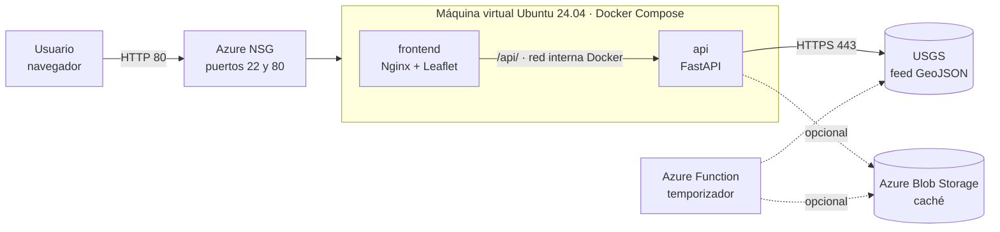

<p align="center">
  
</p>

<h1 align="center">SismoWatch</h1>
<p align="center"><b>Monitoreo sísmico global en tiempo real, diseñado para la nube</b></p>

<p align="center">
  <a href="http://sismowatch.eastus.cloudapp.azure.com/"><b>▶ Servicio en producción</b></a> (HTTP) ·
  <a href="../../actions/workflows/ci-cd.yml"></a>
</p>

---

## 1. Resumen

SismoWatch es un servicio web público que muestra en un mapa los terremotos ocurridos en el mundo y avisa, con una animación y un sonido, cuando aparece un sismo nuevo. Los datos provienen del *Earthquake Hazards Program* del Servicio Geológico de los Estados Unidos (USGS).

El proyecto se desarrolló como caso práctico de **aplicaciones nativas de la nube**: microservicios, contenedores, automatización DevOps, funciones sin servidor y diseño orientado a la resiliencia y la escalabilidad, desplegado en **Microsoft Azure**.

## 2. Caso de negocio

> Nota: las secciones de mercado y financiamiento son **hipótesis de trabajo** que deben validarse con clientes reales; no se incluyen cifras de mercado no verificadas.

### 2.1 Problema
La información sísmica existe y es pública, pero se presenta en herramientas pensadas para especialistas: catálogos extensos, formatos técnicos y poca capacidad de alerta inmediata. Organizaciones que dependen de la continuidad de sus operaciones necesitan una vista **simple, en vivo y accionable**.

### 2.2 Cliente objetivo
- Aseguradoras y reaseguradoras (seguimiento de eventos que pueden generar siniestros).
- Constructoras e ingeniería (conciencia del riesgo en proyectos y obras).
- Logística y operadores de infraestructura (rutas, bodegas, plantas).
- Entidades públicas y gestión del riesgo a nivel local.
- Instituciones educativas (divulgación y enseñanza).

### 2.3 Propuesta de valor
- Mapa en tiempo casi real con filtros por periodo, magnitud, profundidad y país o región.
- **Alerta inmediata**: pulso visual y sonido cuando aparece un sismo nuevo.
- Ficha de detalle dentro de la propia página, con explicaciones en lenguaje sencillo (por ejemplo, qué significa el tipo de magnitud *mww* o *md*).
- Arquitectura portable y de bajo costo, que puede ejecutarse en cualquier nube.

### 2.4 Modelo de negocio (hipótesis)
| Nivel | Contenido |
|---|---|
| Gratuito | Mapa público, filtros y detalle de eventos. |
| Profesional | Alertas configurables por zona y magnitud (correo, mensajería), historial y exportación. |
| Empresarial | API con acuerdo de nivel de servicio, panel por organización y soporte. |

### 2.5 Uso previsto de fondos (a definir por el equipo)
Infraestructura con alta disponibilidad, módulo de alertas multicanal, integración de fuentes adicionales (regionales y de otras agencias), aplicación móvil y validación comercial con los primeros clientes.

### 2.6 Riesgos y mitigación
| Riesgo | Mitigación |
|---|---|
| Dependencia de una única fuente de datos | Diseño con caché y capa de ingesta separada para incorporar nuevas fuentes. |
| Competencia de mapas gratuitos | Diferenciación en alertas, experiencia de uso, API y soporte. |
| Caída del servidor único | Reinicio automático, verificaciones de salud y plan de autoescalado (sección 11). |

## 3. Trabajo realizado

### 3.1 Funcionalidades
- Mapa interactivo (Leaflet) con círculos proporcionales a la magnitud y color por profundidad o magnitud.
- Actualización automática cada 30 segundos y **detección de sismos nuevos** con animación de punto rojo expansivo y sonido (Web Audio).
- Panel lateral ocultable con filtros: periodo, magnitud mínima, profundidad, texto, país o región, solo lo visible en el mapa, aviso de tsunami y sismos sentidos.
- Panel de detalle con hora local (Bogotá) y UTC, coordenadas, profundidad, alerta PAGER, intensidades, calidad del dato y el **método de cálculo de la magnitud explicado**.
- Pantalla de carga con el logotipo y porcentaje de avance real; ícono de la pestaña con el logotipo.
- Mapas base oscuro, claro, calles y satélite; diseño adaptable a celulares.

### 3.2 Fuente de datos
Se eligió el feed GeoJSON de USGS porque es público, gratuito, no requiere llave, se actualiza cada minuto aproximadamente, tiene cobertura global y formato estándar.

**Evaluación del Servicio Geológico Colombiano (SGC).** Se probó integrar los archivos públicos del SGC. Desde la máquina virtual en Azure el servidor del SGC respondió `AccessDenied` aunque la petición se identificara como navegador, y desde el navegador los datos no pueden leerse porque el servidor no envía las cabeceras CORS. Por ello la versión final usa únicamente USGS. El diseño deja preparada la incorporación de otras fuentes mediante una capa de ingesta separada (carpeta `function/`).

## 4. Arquitectura



Flujo de una consulta: el navegador pide la página al contenedor `frontend` (Nginx); las peticiones a `/api/` se reenvían por la red interna de Docker al contenedor `api`, que responde desde su caché en memoria (30 s), desde Blob Storage si está configurado, o consulta directamente a USGS. Si la API falla, la página consulta a USGS directamente.

## 5. Cumplimiento de los principios de diseño nativo de la nube

Leyenda: ✔ implementado · ◐ parcial · ○ planificado

| Principio | Implementación | Estado |
|---|---|---|
| Microservicios | Dos servicios independientes (`frontend` y `api`) que se comunican por HTTP/JSON | ✔ |
| Contenedorización | Un `Dockerfile` por servicio; Docker Compose | ✔ |
| Orquestación | Docker Compose con red, reinicio automático y *healthcheck*. Kubernetes no se implementó | ◐ |
| DevOps y CI/CD | GitHub Actions: pruebas, construcción con prueba de humo y despliegue por SSH (requiere secretos) | ✔ / ◐ |
| Sin servidor | Código de Azure Function (ingesta por temporizador hacia Blob Storage) en `function/`; **no está desplegada** | ◐ |
| Resiliencia | Reinicio automático, verificación de salud, respaldo caché → USGS, tiempos de espera; servidor único | ◐ |
| Escalabilidad | Plan de autoescalado con VM Scale Set y balanceador (sección 11) | ○ |
| Independencia del proveedor | Docker/Compose funciona en cualquier nube; Azure se usa solo como infraestructura | ✔ |

## 6. Tecnologías

Python 3.12 · FastAPI · Uvicorn · HTTPX · Nginx · Leaflet · JavaScript · Docker · Docker Compose · GitHub Actions · Azure (VM Ubuntu 24.04, NSG, IP pública con nombre DNS) · Azure Functions y Blob Storage (código opcional).

## 7. Estructura del repositorio

```
sismowatch/
├── api/                    # Microservicio de datos (FastAPI)
│   ├── main.py
│   ├── test_main.py        # Pruebas automáticas
│   ├── requirements.txt
│   └── Dockerfile
├── frontend/               # Microservicio web (Nginx + Leaflet)
│   ├── index.html
│   ├── nginx.vm.conf       # Proxy inverso hacia la API
│   └── Dockerfile
├── function/               # Azure Function de ingesta (opcional, no desplegada)
├── docker-compose.yml      # Ejecución local
├── docker-compose.vm.yml   # Ejecución en la máquina virtual
├── deploy.sh               # Alternativa: Azure Container Apps (no usada en producción)
├── docs/img/logo.png
└── .github/workflows/ci-cd.yml
```

## 8. Ejecución local

Requisitos: Docker con Compose.

```bash
docker compose up --build
```
Abrir `http://localhost:8080`. La API queda en `http://localhost:8000/health`.

## 9. Despliegue en Azure (máquina virtual)

1. Crear una VM Ubuntu Server 24.04 con IP pública estática y abrir los puertos 22 y 80 en el grupo de seguridad de red.
2. Asignar una etiqueta de nombre DNS a la IP pública (por ejemplo `sismowatch`), con lo que se obtiene `sismowatch.<región>.cloudapp.azure.com`.
3. Instalar Docker: `curl -fsSL https://get.docker.com | sudo sh && sudo usermod -aG docker $USER`.
4. Clonar este repositorio en `~/sismowatch` y ejecutar:
   ```bash
   cd ~/sismowatch
   docker compose -f docker-compose.vm.yml up -d --build
   ```

## 10. Integración y despliegue continuos

El flujo `.github/workflows/ci-cd.yml` se ejecuta en cada `push` y `pull request`:

1. **Pruebas**: ejecuta las pruebas de la API con `pytest`.
2. **Construcción**: levanta la pila con Docker Compose, verifica `/health` y la página principal, y la detiene.
3. **Despliegue** (solo en `main` y solo si existen secretos): se conecta por SSH a la VM, actualiza el código (`git pull`) y reconstruye los contenedores.

Para activar el paso 3, en *Settings → Secrets and variables → Actions* se crean los secretos `VM_HOST`, `VM_USER` y `VM_SSH_KEY`. Si no existen, el flujo ejecuta solo la integración continua.

## 11. Resiliencia y escalabilidad

**Implementado**
- Política `restart: unless-stopped` y verificación de salud en la API.
- Respaldo en cascada: caché en memoria → Blob Storage → USGS; y, en el navegador, consulta directa a USGS si la API no responde.
- Servicios sin estado: cualquier réplica puede atender cualquier petición.

**Plan de escalado automático (pendiente de implementar)**
1. Crear una imagen de la VM ya configurada (contenedores y Docker incluidos).
2. Crear un *Virtual Machine Scale Set* con esa imagen detrás de un *Azure Load Balancer* con sonda de salud en `/health`.
3. Regla de autoescalado: añadir una instancia cuando el uso promedio de CPU supere el 70 % durante 5 minutos y retirarla cuando baje del 30 % durante 10 minutos.
4. Pruebas de carga y de falla (apagar una instancia) para validar la disponibilidad.

## 12. Seguridad y costos

- Autenticación SSH por clave; las claves y el archivo `.env` están excluidos del repositorio (`.gitignore`).
- Mejoras recomendadas: restringir el puerto 22 a una IP conocida, habilitar HTTPS con un certificado automático y limitar el origen CORS de la API.
- Costo: VM de la serie B (bajo costo) y recursos sin licencias. Se recomienda configurar un presupuesto con alertas en Azure.

## 13. Pruebas

```bash
cd api
pip install -r requirements.txt pytest
pytest -q
```
Las pruebas verifican el estado de salud, el filtrado por magnitud, la validación de parámetros, el respaldo hacia USGS y la respuesta 503 cuando no hay datos.

## 14. API

| Método | Ruta | Descripción |
|---|---|---|
| GET | `/health` | Estado del servicio |
| GET | `/api/earthquakes?period=day&min_mag=2.5` | Sismos en formato GeoJSON. `period`: `hour`, `day`, `week`, `month`. Incluye `metadata` con fuente, fecha y total |

## 15. Limitaciones y trabajo futuro

- Un único servidor: el autoescalado y el balanceador están planificados.
- El servicio usa HTTP; falta habilitar HTTPS.
- Kubernetes y la Azure Function de ingesta no están desplegados.
- Una sola fuente de datos (USGS); la integración del SGC no fue viable por restricciones de acceso del lado del proveedor.
- Alertas por correo o mensajería, historial y cuentas de usuario.

## 16. Créditos y licencias de datos

- Datos sísmicos: USGS Earthquake Hazards Program (información pública del Gobierno de los Estados Unidos).
- Mapas base: © colaboradores de OpenStreetMap; imágenes y mapas base de Esri. Cumplir sus términos de uso en producción.
- Cartografía interactiva: [Leaflet](https://leafletjs.com/).
